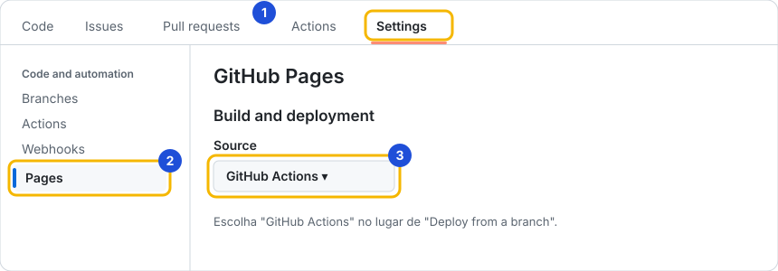
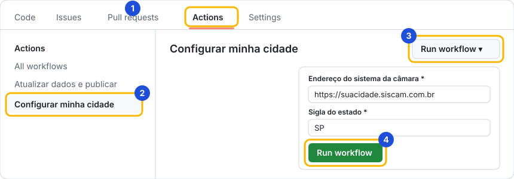

# Radar Cidades

O que cada vereador apresentou desde a posse, contado todo dia a partir do sistema oficial da Câmara Municipal. Feito para Rio Claro-SP e pronto para qualquer cidade copiar.


Roda de graça: a coleta é feita pelo GitHub Actions e o site é publicado no GitHub Pages. Sem servidor, sem VPS, sem senha ou segredo para configurar.

O site mostra, para cada legislatura:

- quantos documentos de cada tipo os vereadores apresentaram (pedidos nos bairros, perguntas e cobranças, homenagens, propostas de lei), no total, mês a mês e por vereador;
- o perfil de cada vereador comparado com a média da Câmara, com link e imagem para compartilhar;
- as ruas que mais aparecem nos pedidos, agrupadas por rua e bairro, e os pedidos repetidos (o mesmo serviço pedido três vezes ou mais no mesmo endereço);
- se a Prefeitura responde: taxa e tempo de resposta aos requerimentos, vetos mantidos ou derrubados, projetos do prefeito comparados com os dos vereadores;
- o dinheiro da cidade (municípios de SP): quanto veio do Estado e do governo federal, para onde foi, as 10 a 30 empresas que mais receberam e um contador da folha de pagamento do mês;
- um cartão do prefeito, com tudo o que ele enviou à Câmara;
- o resultado das votações em plenário;
- presença nas sessões, quando a Câmara publica a lista.

---

## Parte 1 — Publicar na sua cidade em 10 minutos

Sem programar. Você precisa de uma conta no GitHub e do endereço do sistema legislativo da sua Câmara. O radar lê dois sistemas:

| Sistema | Como reconhecer |
|---|---|
| **SISCAM** (SINO Informática) | endereço como `suacidade.siscam.com.br`; rodapé com "SINO Informática" |
| **SAPL** (Interlegis) | endereço como `sapl.suacidade.uf.leg.br` |

**1. Copie o projeto.** Nesta página, clique em **Use this template → Create a new repository**. Dê um nome (ex.: `radar-minhacidade`), deixe **Public** e confirme.

**2. Ligue a publicação.** No repositório novo: **Settings → Pages → Build and deployment → Source: GitHub Actions**.



**3. Diga qual é a sua cidade.** Aba **Actions** (confirme se pedir para habilitar os fluxos) → **Configurar minha cidade** → **Run workflow**. Cole o endereço do sistema da Câmara, digite a sigla do estado e clique no botão verde.



O robô descobre o sistema, os códigos dos tipos de documento e o nome da cidade, grava o `cidade.json`, apaga os dados de Rio Claro e dispara a primeira coleta.

**4. Espere.** A primeira coleta lê tudo desde a posse e leva de 5 a 15 minutos. Quando o fluxo **Atualizar dados e publicar** ficar verde, o site está em `https://SEU_USUARIO.github.io/NOME_DO_REPOSITORIO/`.

Daí em diante ele se atualiza sozinho todo dia às 06:17. O mesmo passo a passo está no próprio site, na página `/como-fazer`.

**Repositório privado ou anonimato?** O GitHub Pages gratuito só publica repositório público. Para manter o repositório privado e o site público, e para não aparecer como dono do projeto, siga [docs/PUBLICAR.md](docs/PUBLICAR.md).

**Ajustes opcionais**

- Nome do site: edite `titulo_site` no `cidade.json` (dá para editar pelo GitHub, no lápis).
- Domínio próprio: preencha `dominio` no `cidade.json` e crie um CNAME no seu provedor apontando para `SEU_USUARIO.github.io`.
- Atualizar na hora: Actions → Atualizar dados e publicar → Run workflow.

### Cidades usando

| Cidade | Sistema | Site |
|---|---|---|
| Rio Claro-SP | SISCAM | https://onetapbr.github.io/SeeALL/ |

Publicou o da sua cidade? Abra uma issue ou um pull request acrescentando uma linha aqui.

---

## Parte 2 — Como funciona

```
cidade.json            a cidade: nome, sistema, endereço, códigos dos tipos
scraper/
  configurar.py        detecta o sistema de uma câmara e grava o cidade.json
  coletar.py           lê a câmara → dados/<ano-da-posse>/bruto.json
  gerar.py             classifica e calcula → site/data/, site/og/, site/v/
  classificar.py       regras: categoria, tema, rua/bairro, votação, veto
  financas.py          receitas e despesas do município (dados abertos do TCE-SP)
  cartoes.py           imagens de compartilhamento (Pillow)
  presenca_ata.py      lê lista de presença de ata em PDF (pdfplumber)
  fontes/base.py       interface comum e formato dos dados
  fontes/siscam.py     adaptador SISCAM (lê as páginas de pesquisa)
  fontes/sapl.py       adaptador SAPL (API REST)
site/                  site estático: index.html, styles.css, app.js, como-fazer/
dados/                 dados brutos por legislatura (versionados: o histórico mostra o que mudou a cada dia)
tests/                 pytest com páginas e respostas de API reais salvas em tests/fixtures
exemplos/              cidade.json de Rio Claro (SISCAM) e de Patos de Minas (SAPL)
.github/workflows/     atualizar.yml (diário) e configurar.yml (uma vez)
```

### Rodar no seu computador

```bash
pip install -r scraper/requirements.txt
python -m pytest tests                 # testes
python scraper/coletar.py              # coleta (incremental se já houver dados)
python scraper/gerar.py                # gera site/data, cartões e páginas de vereador
python -m http.server 8000 -d site     # http://localhost:8000
```

Para testar outra cidade sem mexer na sua, use uma pasta de saída:

```bash
python scraper/coletar.py --cidade exemplos/cidade.patos-de-minas-mg.json --saida /tmp/patos
python scraper/gerar.py   --cidade exemplos/cidade.patos-de-minas-mg.json --saida /tmp/patos
python -m http.server 8001 -d /tmp/patos/site
```

### cidade.json

| Campo | Para que serve |
|---|---|
| `nome`, `uf`, `slug`, `titulo_site` | textos do site |
| `sistema` | `siscam` ou `sapl` |
| `url_base` | endereço do sistema da Câmara |
| `posse_inicial` | uma data de posse conhecida (`2025-01-01`); as outras legislaturas são calculadas de 4 em 4 anos |
| `codigos_tipos` | código → nome dos tipos de documento a coletar (no SAPL, vazio = todos os reconhecidos) |
| `siscam` | ids dos módulos e dos tipos de sub-documento (resposta, veto, ata) |
| `mesclar_autores` | junta cadastros duplicados da mesma pessoa (`{"2092": 68}`) |
| `prazo_resposta_dias` | a partir de quantos dias um requerimento sem resposta conta como atrasado (30) |
| `dominio` | domínio próprio, opcional |
| `tce_sp` | nome do município na API do TCE-SP (`rio-claro`); liga a seção de finanças |
| `prefeito` | `nome`, `partido` e `foto` para o cartão do prefeito (opcional) |
| `subsidios` | valores mensais fixados em lei: `vereador`, `presidente_camara`, `prefeito`, `vice_prefeito`, `secretario`, e `fonte` (opcional) |
| `repositorio` | endereço do código; vazio = o site não mostra link para o repositório |

`python scraper/configurar.py <url> --uf SP` preenche tudo isso sozinho.

### Fontes de dados

Cada sistema tem um adaptador em `scraper/fontes/` que implementa a mesma interface (`vereadores()`, `proposituras()`, `votacoes()`, `respostas()`, `vetos()`, `sessoes()`) e devolve o mesmo formato, descrito em `base.py`. O resto do projeto não sabe de onde o dado veio. Para um sistema novo, basta um adaptador novo.

**SISCAM.** Não tem API; o coletor lê a pesquisa avançada (`/Documentos/Pesquisa/80?Pesquisa=Avancada…`, 15 itens por página) em duas passadas: uma por tipo de documento, para o conteúdo, e uma por autor (`AutoriaId`), para saber de quem é cada documento. Casar autor por nome perde documentos, porque o nome impresso muda com o tempo e "Autoria" e "Coautoria" são campos separados. Respostas e vetos são sub-documentos (módulo 87) ligados ao documento principal.

**SAPL.** Usa a API REST: matérias, autores, parlamentares da legislatura, mandatos, votações com placar e presença por sessão.

| Dado | SISCAM | SAPL |
|---|---|---|
| Proposituras e autoria | sim | sim |
| Suplentes e ex-vereadores | sim (sem distinguir um do outro) | sim |
| Resultado das votações | texto das observações | placar registrado |
| Resposta do Executivo a requerimentos | sim | não existe no sistema |
| Vetos | sim | sim |
| Presença nas sessões | só se as atas forem públicas | sim |

### Legislaturas

Não há data de posse fixa no código. A legislatura vigente é a de 1º de janeiro de `2025 + 4k` mais recente. Cada uma fica em `dados/<ano>/` e `site/data/<ano>/`, e o site ganha um seletor no topo quando há mais de uma. Na virada, a anterior recebe uma última coleta completa e vira arquivo. Para trazer uma legislatura passada: `python scraper/coletar.py --legislatura 2021`.

Vereadores de uma legislatura = lista atual da Câmara + todo autor do tipo vereador que apresentou documento no período. Quem está fora da lista atual aparece marcado como suplente ou ex-vereador.

### Coleta incremental

A coleta diária relê só os últimos 60 dias e os projetos de lei (cuja situação muda ao longo dos meses) e leva cerca de dois minutos. Documento excluído pela Câmara dentro da janela some do radar também. Uma vez por semana a coleta volta a ser completa. `--completa` força.

### Classificação

| Categoria | Regra |
|---|---|
| Pedidos de melhoria nos bairros | Indicações, e requerimentos que pedem um serviço (buraco, poda, limpeza, iluminação, sinalização…) |
| Perguntas e cobranças | Requerimentos que pedem informação ou explicação |
| Homenagens | Moções de congratulação, louvor, aplauso e pesar, títulos, medalhas, nome de rua, datas comemorativas |
| Propostas de lei | Projetos de lei, de lei complementar e de emenda à Lei Orgânica que não são homenagem |
| Outros | Moções de apoio, repúdio ou apelo, decretos legislativos e resoluções que não são homenagem |

As regras ficam em `scraper/classificar.py` e têm testes em `tests/test_classificar.py`. Rua, bairro e tema também são lidos do texto do assunto.

**A Prefeitura responde?** Um requerimento conta como respondido quando tem um sub-documento "Resposta" no sistema. A conta começa no primeiro requerimento que teve resposta registrada: antes disso a Câmara não lançava as respostas, e marcar tudo como "sem resposta" seria injusto. Em Rio Claro isso significa 2026 em diante. Requerimento sem resposta só conta como atrasado depois de 30 dias.

**Votações.** No SISCAM não há voto nominal; o resultado vem do campo "Observações" de cada projeto ("Aprovado por 15 votos favoráveis e 01 contrário…"). Redação final não entra.

### O dinheiro da cidade

`scraper/financas.py` lê a API de dados abertos do Tribunal de Contas do Estado de São Paulo (`transparencia.tce.sp.gov.br/api/json/receitas|despesas/<municipio>/<ano>/<mes>`), que cobre todos os municípios paulistas menos a capital, com cerca de dois meses de atraso. Cada mês vira um resumo em `dados/financas.json`; os três últimos são relidos a cada coleta.

- **Receita por origem**: pelo código da natureza. `171…`/`241…` é União, `172…`/`242…` é Estado, `175…` é Fundeb, o resto é arrecadação própria. Receita intraorçamentária e contribuição previdenciária ficam de fora.
- **Despesa**: só o que foi pago. A API diz quem recebeu, não o que foi comprado nem a secretaria. Repasses entre órgãos do próprio município e pagamentos a pessoas físicas não entram no ranking.
- **Folha de pagamento**: o que cada órgão pagou a si mesmo ou a um credor "folha de pagamento". É assim que a folha aparece nessa fonte; não há valor por pessoa. O contador da página inicial reparte a folha do último mês publicado ao longo do mês atual: é uma estimativa.
- **Salário de vereador e de prefeito**: o subsídio é fixado por lei municipal e não está nos dados abertos. Preencha `subsidios` no `cidade.json` com o valor e a lei, e o site mostra.

### Voto de cada vereador: por que não tem

O SISCAM de Rio Claro registra só o placar final ("Aprovado por 15 votos favoráveis e 01 contrário"). Não há voto nominal, abstenção nem lista de presença em nenhuma fonte pública que dê para ler: o site da Câmara traz apenas a ordem do dia de cada sessão, e as atas estão em acesso controlado. O perfil do vereador explica isso e mostra os gráficos sozinho quando o dado existir (em cidades com SAPL a presença já aparece). O caminho para conseguir é um pedido pela Lei de Acesso à Informação à Câmara, solicitando a publicação das atas e do registro nominal de votação.

### Presença nas sessões em Rio Claro: por que não tem

As atas de 2026 existem no SISCAM (tipo "Ata da Sessão", código 530) e aparecem listadas na página dos membros da Mesa, mas o conteúdo está em **acesso controlado**: a página do documento (`/Documentos/Documento/<id>`) e o arquivo (`/Documentos/Arquivo/<id>`) devolvem 404 para o público, e o sistema pede chave e senha em `/Documentos/AcessoControlado`. A página de cada sessão (`/Sessoes/Sessao/<id>`) só traz o expediente. Não há atas de 2025 no sistema.

Por isso a seção fica oculta em Rio Claro e o rodapé do site explica o motivo. O código está pronto: a cada coleta completa o robô tenta de novo, e se a Câmara abrir as atas (e elas trouxerem a lista de presentes) a seção aparece sozinha. A "autoria" das atas no sistema não serve como presença: ela registra só quem assinou, os membros da Mesa.

### Testes

`python -m pytest tests` roda em menos de um segundo, sem internet: o parser do SISCAM e o adaptador do SAPL são testados contra páginas e respostas reais salvas em `tests/fixtures/`, e as regras de classificação contra frases de exemplo.

---

## Licença e aviso

Código sob [licença MIT](LICENSE). As fontes Archivo e Public Sans usadas nos cartões estão sob a SIL Open Font License (`scraper/tipos/`).

Os dados são públicos e vêm do sistema oficial de cada Câmara; cada item do site tem o link para o documento original. A classificação é automática e pode errar. Projeto independente, sem ligação com partidos, prefeituras ou câmaras.
